  

  
  
  

---

### 🛰️ About me

- 🎓 Junior studying **Computer Science** at **Florida Atlantic University**
- 🚀 **Director of Outreach** at the FAU Aerospace Experimental Association (AXA) — building and researching **CubeSats** with the team
- 🤖 Mission objective: **applying AI to aerospace** — NASA is the destination
- 👁️ Currently exploring **Machine Learning**, **Orbital Mechanics**, and **C++ Simulations**
- 🧮 Mathematics tutor — happy to talk math

---

### 🧰 Tech stack

  

  
  
  
  
  

---

### 🌌 Mission log

| Project | Description | Stack |
|---|---|---|
| 💡 [**home-energy**](https://github.com/ryanccalixte/home-energy) | An AI agent that estimates your appliances' energy usage through computer vision and chat box | React · TensorFlow.js · Ollama · Flask |
| 🚶 [**pedestrian-detector**](https://github.com/ryanccalixte/pedestrian-detector) | Real-time pedestrian and crosswalk detection with YOLO + pose estimation | Python · YOLO |
| 📊 [**data-plotter**](https://github.com/ryanccalixte/data-plotter) | Upload a CSV, pick a chart style, get an interactive dashboard | FastAPI · Plotly · pandas |
| 🧠 [**health-compass**](https://github.com/ryanccalixte/health-compass) | 🥈 **2nd place, 2026 FAU Biotech Hackathon** — raises awareness of Parkinson's risk by flagging early symptoms | TypeScript |
| 🏠 [**housing-price-predictor**](https://github.com/ryanccalixte/housing-price-predictor) | Random Forest regression with a full preprocessing pipeline | Python · scikit-learn |
| 🌐 [**4HTechGarage-Website**](https://github.com/ryanccalixte/4HTechGarage-Website) | Nonprofit site that helped raise **$60,000** | HTML/CSS · Javascript |

---

### 📡 Telemetry

  
  

  

---

### 🐍 Orbital activity

<picture>
  <source media="(prefers-color-scheme: dark)" srcset="https://raw.githubusercontent.com/ryanccalixte/ryanccalixte/output/github-snake-dark.svg"/>
  <source media="(prefers-color-scheme: light)" srcset="https://raw.githubusercontent.com/ryanccalixte/ryanccalixte/output/github-snake.svg"/>
  
</picture>

<i>Ad astra per aspera</i> ✦

